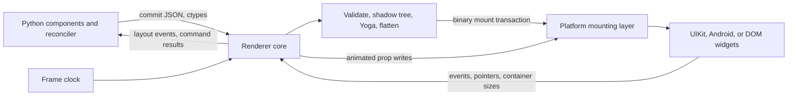

# RFC 0007: Shared renderer core

- Status: Implemented
- Author(s): Owen Carey, with Claude (Claude Code)
- Created: 2026-10-21
- Implemented in: (pull request links, once shipped)
- Supersedes / Superseded by: replaces the per-platform commit validation,
  layout, list store, and animation graph from RFC 0003, the generated
  Swift and Kotlin contract validators from RFC 0003 and RFC 0005, and the
  Python layout and gesture paths that serve only tests and the browser
  preview

## Summary

PythonNative's renderer is written four times. Swift, Kotlin, and the
browser preview each validate commits, keep a shadow tree, map styles to
Yoga, lay out, store list datasets, and evaluate animation graphs; Python
carries a fourth partial copy for headless tests and the preview's
gestures. The copies have already drifted. All of that work runs on the
platform UI thread inside a synchronous hop from Python, and leaf
measurement asks live widgets for their size, which pins layout to that
thread.

This RFC replaces those copies with one C++ library, the renderer core,
linked into every target: iOS, Android, the browser preview (as
WebAssembly), and the host interpreter that runs tests. Python hands the
core a commit through a C ABI; the core validates it once, updates the
shadow tree, lays it out off the UI thread, flattens layout-only views,
and queues a compact mount transaction that the UI thread applies without
waiting on anyone. Swift, Kotlin, and JavaScript shrink to what each
platform genuinely owns: widgets, text drawing, input, scrolling,
navigation containers, accessibility, and device modules. It's
PythonNative's equivalent of React Native's New Architecture renderer.

It also fixes the correctness bugs that the audit behind it found on the
same paths.

## Motivation

An October 2026 audit (v0.51.0) of the Python runtime, the native hosts,
the tooling, and the public API found that the runtime's feature surface
matches React Native's, but its structure doesn't.

### The renderer is written four times

Every subsystem below the reconciler exists once per platform, plus
partial Python and JavaScript copies:

| Subsystem | iOS (Swift) | Android (Kotlin) | Browser (JS) | Python |
| --- | --- | --- | --- | --- |
| Commit validation and undo | `PNCommit.swift` (181) | `CommitState.kt` (220) | `Renderer` in `renderer.js` | `bridge/commits.py` (231) |
| Op decoding and mounting | `PNTransaction.swift` (212) | `PNTransaction.kt`, `TransactionApplier.kt` (194) | `renderer.js` | `bridge/fake.py` |
| Shadow tree and Yoga mapping | `PNLayout.swift` (238) | `NativeLayout.kt`, `YogaNode.kt`, `yoga_jni.cpp` (292) | `layout.js` (163) plus vendored Yoga WASM | `layout.py`, `reconciler/layout_pass.py` (765) |
| Prop validators (generated) | `PNContracts.swift` (5,544) | `PNContracts.kt` (5,520) | `contracts.js` (56) | `sdk/schema.py` |
| List datasets | `PNListStore.swift` (122) | `ListStore.kt` (97) | `list-store.js` (90) | `bridge/list_store.py` (135) |
| Animation graph and drivers | `PNAnimationGraph.swift`, `PNAnimator.swift` (778) | `AnimationGraph.kt`, `AnimationSpecs.kt`, `PNAnimator.kt` (621) | `animation_graph.js`, `Animator` in `renderer.js` | `animated.py` ticker and drivers (about 320) |
| Gesture recognition | UIKit recognizers | `GestureRecognizers.kt`, `GestureArbiter.kt` (887) | forwards pointers to Python | `gestures.py` recognizers and arbiter (864) |
| Style string to Yoga parser | `native/yoga/style.cpp` (332), shared | shared | Yoga WASM | `layout.py` |

About 3,000 to 3,500 hand-written lines per platform, roughly 30 percent of
each native runtime, are platform-neutral, and so are the 11,000 generated
validator lines. Every new component or style property costs four
implementations, and the copies already disagree:

- iOS forces `overflow: hidden` on `ScrollView`, `VirtualList`, and
  `ScreenStack`; Android doesn't (`PNLayout.swift:144-146`,
  `NativeLayout.kt:124`).
- The platforms disagree on which components are measured leaves: iOS
  leaves `Screen` out, and Android includes it (`PNLayout.swift:148`,
  `NativeLayout.kt:30`).
- iOS clamps a Yoga insertion index; Android passes it through
  unclamped, which is undefined behavior in `YGNodeInsertChild` when a
  detached header slot makes the logical index exceed Yoga's child count
  (`PNLayout.swift:100`, `NativeLayout.kt:81`).
- An invalid view command returns an error envelope on iOS and `null` on
  Android (`PNBridge.swift:187-189`, `PNBridge.kt:146-151`).

### The UI thread does the renderer's work

A state update reaches the screen like this today:

1. The application loop serializes the commit (`json.dumps`) after
   validating its structure again in Python (`CommitState.prepare`).
2. An executor worker calls into native through ctypes or Chaquopy.
3. Native parses the JSON (`JSONSerialization` or `JSONObject`), then
   blocks on `DispatchQueue.main.sync` or a main-looper `FutureTask`.
4. On the UI thread, native validates the commit with the generated
   predicates, mounts it, updates its Yoga tree, and lays out. Leaf
   measurement calls `sizeThatFits` or `View.measure` on live widgets.
5. The UI thread serializes an acknowledgement with layout frames, and
   Python parses it on the application loop.

The UI thread does validation, layout, and measurement for every commit,
so a large commit drops frames. A commit costs two encodes, two decodes,
three thread handoffs, and three loop turns before acknowledgement. Every
layout-only `Row` and `Column` becomes a real `UIView` or `FrameLayout`
because nothing flattens them. Python's "async" handle methods
(`TextInputHandle.get_value`, `ScrollViewHandle.get_scroll_offset`,
`WebViewHandle.can_go_back`) block the loop on a synchronous main-thread
hop (`handles.py:114-117, 142-145, 194-196`); in the browser preview that
can stall for up to the 15-second WebSocket timeout.

### Tests don't run the renderer that ships

Headless tests lay out through a Python Yoga binding and synthetic `f`
(frame) operations that no device transport accepts
(`reconciler/layout_pass.py:201-213`, `bridge/fake.py`). The browser
preview's gestures run in a Python arbiter on the host
(`bridge/web.py:379-384`). A layout or gesture bug can pass every Python
test and still ship.

### Correctness bugs on the same paths

These were reproduced or confirmed in source during the audit:

1. **A failing effect runs its previous cleanup twice and drops sibling
   effects.** `flush_pending_effects` runs the old cleanup, the new effect
   raises, and the slot still holds the old cleanup, which the error
   boundary's unmount runs again (`hooks.py:417-438`; the layout-effect
   loop at `hooks.py:402-415` has the same shape). Effects queued after
   the failing one in the same component never run. Reproduced:
   `['run 0', 'cleanup 0', 'run 1', 'cleanup 0']`.
2. **`use_transition` never reports a pending state on device.** The host
   adds its own `call_threadsafe` turn (`hosts/native.py:56-64,
   166-178`) after the transition lane's flush (`scheduler.py:168-174`).
   Setters apply eagerly, so `set_pending(True)` and `set_pending(False)`
   net out and the urgent and transition updates render together.
   Reproduced with native-style scheduling: renders were
   `[('', '', False), ('a', 'a', False)]`; headless tests, which render
   inline, see the pending render.
3. **`pn.Animated.View(..., ref=r)` raises `TypeError: got multiple values
   for keyword argument 'ref'`** (`animated.py:1834-1873`), so a view
   can't be animated and hold a handle at once. Reproduced.
4. **Async handle methods block the loop** (above).
5. **Unmounting is quadratic.** `BridgeBackend._forget` scans every event
   sequence for each destroyed tag (`bridge_backend.py:399-407`), and
   `AnimationGraph.forget` scans every graph and binding for each destroy
   on both platforms (`PNAnimationGraph.swift:61-68`,
   `AnimationGraph.kt:80-88`).
6. **Android recreates the activity on rotation, dark-mode, locale, and
   font-scale changes.** The template's `MainActivity` declares no
   `android:configChanges`
   (`templates/android_template/app/src/main/AndroidManifest.xml:16-26`),
   so the comment at `PNScreenFragment.kt:128` ("handled in-place") is
   wrong, and a commit that arrives between `clearContext` and
   `setContext` fails the surface (`PNBridge.kt:110-111`).
7. **Android's Yoga measure callbacks are unsafe.** They call
   `GetMethodID` on every measurement, never call `ExceptionCheck` (a
   Kotlin exception inside `measure` is followed by more JNI calls, which
   aborts under CheckJNI), and assume `GetEnv` succeeds on an attached
   thread (`yoga_jni.cpp:9-24`).
8. **`pn deps --lock` prints a traceback instead of its report** when a
   target can't resolve: `lockfile.write` raises `DependencyError` before
   the report is formatted (`cli/pn.py:513-531`, `lockfile.py:26-27`).
9. **A stale `pn.lock` crashes `pn run` with a traceback.** Plugin
   discovery reads the lock (`plugins.py:577`) and raises
   `DependencyError` or `PluginError`, neither of which is a `BuildError`,
   so the CLI doesn't catch them (`cli/pn.py:845, 876`). That also
   contradicts `building-for-release.md`, which says development builds
   can resolve unlocked requirements.

## Reference behavior

React Native's New Architecture moved the renderer into shared C++
(Fabric). JavaScript commits a new shadow tree to C++; layout runs in C++
with Yoga on the JavaScript or a background thread; text is measured
through a thread-safe platform text layout manager; a "differentiator"
flattens layout-only views and computes mount instructions; and each
platform's mounting layer applies those instructions on the UI thread.
Native-initiated changes (an image's intrinsic size, a container's
bounds) arrive as state updates that trigger a C++ relayout. JSI lets
JavaScript call into C++ synchronously, for example to measure a view.
React Native Gesture Handler recognizes gestures with its own engine on
Android and wraps UIKit recognizers on iOS.

PythonNative follows the same split, with these deliberate differences:

- **A C ABI instead of host objects.** Python reaches the core through
  `ctypes`, which already binds the iOS bridge and the host Yoga
  extension. One call per commit makes the foreign-call cost
  irrelevant, and a C ABI needs no CPython headers in the Android build,
  where Chaquopy owns interpreter startup.
- **Python still renders; the core lays out.** Components and the
  reconciler stay in Python on the application thread. The core starts at
  the commit, so the authoring model, hooks, and Fast Refresh don't
  change. There's no concurrent rendering and no Python on the UI thread.
- **The commit stays compact JSON, parsed once in C++.** The audit found
  latency and duplicated work, not payload size, to be the cost: a
  one-row list patch is 63 bytes (`rfcs/benchmarks/0003-list-work.json`),
  and `json.dumps` is C code. The mount transaction from the core to the
  platform is binary.
- **Managers keep their dictionaries.** The mount decoder produces the
  `[String: Any]` and `JSONObject` values today's component managers read,
  so the widget code survives mostly unchanged. Typed, field-indexed
  manager reads are a follow-up.
- **The browser preview runs the same core as WebAssembly**, with DOM
  measurement callbacks, instead of a JavaScript re-implementation.

## Design

### Overview



Ownership after this change:

| Owner | Responsibilities |
| --- | --- |
| Python (application thread) | Components, hooks, reconciliation, commit ops, event handlers, effects, device module facades |
| Renderer core (C++) | Contract tables and validation, surfaces and revisions, the shadow tree, Yoga style mapping and layout, measurement caching, view flattening, mount diffing, list datasets, animation graphs and drivers, gesture recognition (Android, browser, tests), color and SVG path parsing, event identity stamping, hit testing |
| Platform (UI thread) | Widget creation and prop application, text drawing, text input and IME, scroll physics, navigation containers and back handling, modal windows, accessibility, image decoding, the frame clock, iOS gesture recognizers, device modules, app lifecycle |

### The core library

The core lives in `src/pythonnative/native/core/` and depends on the
vendored Yoga in `native/yoga/yoga/`:

| Path | Contents |
| --- | --- |
| `include/pn_core.h` | The only public header: a C ABI with opaque handles, plain structs, and C strings |
| `src/value.*` | An immutable value model (null, bool, int64, double, string, array, object) with a JSON parser and writer |
| `src/contracts.*` | Compiles the contract document into indexed tables and validates props, removals, commands, and events against them |
| `src/surface.*`, `src/tree.*` | Surfaces, revisions, shadow nodes, structural validation, and an undo log for rejected commits |
| `src/layout.*` | Typed Yoga style application, detached roots, measurement modes, and the measurement cache |
| `src/flatten.*`, `src/mount.*` | View flattening, the mount diff, and the binary mount transaction writer |
| `src/lists.*` | Revisioned keyed datasets, one instance per side (see [Lists](#lists)) |
| `src/animation.*` | Graph nodes, timing, spring, and decay drivers, easing, color interpolation |
| `src/gestures.*` | Recognizers, velocity tracking, activation and failure offsets, and composition |
| `src/parse/*` | Color (including light and dark pairs) and SVG path data |
| `src/abi.cpp` | The exported C functions; exceptions never cross them |

It's C++20, built four ways:

- **iOS:** a SwiftPM C++ target `PNCore` in `native/core/Package.swift`,
  replacing `YogaCore`. Swift calls the C header directly; Python resolves
  the same symbols with `ctypes.CDLL(None)`, as it does for the bridge
  today.
- **Android:** `libpncore.so` from the module's CMake build, replacing
  `libpn_yoga.so`. Kotlin loads it before Python starts and exports its
  absolute path to Python in `PN_CORE_LIBRARY`; Python opens the same
  loaded image with `ctypes.CDLL`.
- **Host:** the setuptools extension `pythonnative._core`, replacing
  `pythonnative._yoga`. `cibuildwheel` already builds C++ for the host
  wheels. Tests, `pn preview`'s host side, and tooling load it with
  `ctypes`.
- **Browser:** `devserver/static/core/pn_core.js` and `pn_core.wasm`,
  built with a pinned Emscripten by `scripts/build-core-wasm.py`, checked
  in like the vendored Yoga WASM is today, and drift-checked in CI.

### Threads and the deadlock rule

| Thread | Calls into the core | May wait on |
| --- | --- | --- |
| Python application loop | `pn_core_measure`, `pn_core_inspect` (short reads under the core lock) | the core lock |
| Commit worker (the loop's executor) | `pn_core_commit`, with the GIL released by ctypes | the core lock; the UI thread, only for an intrinsic-measurement cache miss |
| Core layout worker (owned by the core) | relayout requested by the platform | the core lock; the UI thread, as above |
| Platform UI thread | `pn_core_mount_next`, `pn_core_mount_finished`, `pn_core_animation_frame`, `pn_core_event`, `pn_core_pointer`, `pn_core_report_*`, list reads | nothing |

The rule that keeps this deadlock-free: **the UI thread never waits on
another thread and never takes the core lock.** It reads mount
transactions from a lock-free queue, owns the mount-side state (list data
sources, animation graphs, gesture recognizers), and posts everything
else (container sizes, intrinsic sizes, relayout requests) to the core
without blocking. Any other thread may therefore wait on the UI thread.

A commit follows these steps:

1. The reconciler builds ops exactly as today and the backend serializes
   one envelope.
2. The commit worker calls `pn_core_commit`. The core parses the
   envelope, validates every op against the contract tables and the
   current tree (rolling back on rejection), applies it, lays out the
   dirty roots, flattens, diffs against the mounted tree, writes a mount
   transaction, pushes it to the queue, calls the platform's
   `schedule_mount`, and returns the acknowledgement. It never waits for
   the mount.
3. Python publishes refs and frames, then runs layout and passive
   effects, as it does after an acknowledgement today.
4. On its next turn, the UI thread drains the queue, applies each
   transaction, and reports `pn_core_mount_finished`.

Effects therefore run after the core accepts and lays out a commit, not
after widgets exist. Commands and animation requests that those effects
issue go through the same queue behind the commit's mount, so they always
reach the widgets it creates. A mount failure (a manager throws, or a
decode fails) marks the surface failed and emits a `host` message,
`surface_failed`; Python resets and remounts through the existing
poisoned-surface path (`docs/concepts/bridge.md#commits`).

### The C ABI

`native/core/include/pn_core.h` is the whole interface. The platform
installs one set of callbacks:

```c
typedef struct {
    void *context;
    void (*schedule_mount)(void *context);   /* drain pn_core_mount_next on the UI thread soon */
    void (*schedule_work)(void *context);    /* call pn_core_work soon, off the UI thread */
    void (*request_frames)(void *context);   /* start calling pn_core_animation_frame */
    void (*measure)(void *context, const pn_measure_request *request, pn_size *size);
    float (*baseline)(void *context, int64_t surface, int64_t tag, float width, float height);
    void (*emit)(void *context, const char *kind, int64_t surface, int64_t tag,
                 const char *name, const char *payload);
} pn_platform;
```

`measure` writes through an out-parameter because ctypes callbacks can't
return structs, and `pn_measure_request` carries the surface, tag,
component name, measurement mode, the props as an encoded value object,
and both Yoga constraints. The functions fall into three groups:

- **Setup:** `pn_core_shared`, `pn_core_protocol_version`,
  `pn_core_set_platform`, `pn_core_load_contracts` (the document and a
  platform name: `ios`, `android`, `web`, or `host`),
  `pn_core_contract_fingerprint`, `pn_core_set_flattening`,
  `pn_core_reset`, and `pn_core_free`.
- **Python:** `pn_core_commit`, `pn_core_layout` (a relayout without a
  commit), `pn_core_command`, `pn_core_animate`, `pn_core_measure`,
  `pn_core_inspect`, `pn_core_validate_module`, `pn_core_check_value`
  (tooling and tests), and `pn_core_work` (deferred relayout, run by
  whichever thread `schedule_work` picks).
- **UI thread:** `pn_core_mount_next` and `pn_core_mount_finished`,
  `pn_core_is_mounted`, `pn_core_report_container`,
  `pn_core_report_intrinsic`, `pn_core_invalidate`,
  `pn_core_invalidate_measurements`, `pn_core_event` (which emits the
  stamped envelope rather than returning it), `pn_core_animation_frame`
  and `pn_core_take_writes`, `pn_core_set_reduce_motion`, the gesture
  calls (`pn_core_pointer`, `pn_core_gesture_deadline`,
  `pn_core_gesture_poll`, `pn_core_has_gestures`), and the list data
  source (`pn_core_list_apply`, `pn_core_list_revision`,
  `pn_core_list_count`, `pn_core_list_key`, `pn_core_list_index`,
  `pn_core_list_extent`, `pn_core_list_sticky`,
  `pn_core_list_row_revision`, `pn_core_list_sticky_at`).

None of the UI-thread functions takes the commit lock. Module validation
reads an immutable snapshot of the contracts that each load publishes,
so a module call on the UI thread never waits for a commit. The core
supports several surfaces, but every host keeps one until multi-window
support has its own RFC.

### Wire contract (protocol 7)

`PROTOCOL_VERSION` becomes 7. Every dev client, including PythonNative
Go, must be rebuilt.

**Commit envelope (Python to core).** The v6 envelope minus the `f`
(frame) op and `SetFrameOp`:

```json
{"version": 7, "application": "3f2a9c", "surface": 1, "revision": 42,
 "ops": [["c", 7, "Text", {"text": "Hi", "_pn_layout": true}],
         ["u", 3, {"background_color": "#fff"}, ["opacity"]],
         ["i", 3, 7, 0],
         ["d", 5]],
 "layout": {"roots": [1], "width": 390, "height": 844, "selective": true}}
```

- The optional `layout` request stays: Python sends the viewport with the
  commit that needs a layout, and `pn_core_layout` relays out without a
  commit when only the viewport changed. Platforms report container and
  intrinsic sizes to the core, which relays out on its own through
  `schedule_work`. `_pn_layout` still marks the tags whose frames Python
  observes.
- The acknowledgement is `{"ok": true, "application", "surface",
  "revision", "layout": {..., "frames": [[tag, x, y, w, h], ...]},
  "metrics": {...}}`, with frames for observed tags only.
- A rejection is `{"ok": false, "failed": false, "application",
  "surface", "revision", "error", "op"}`, where `op` is the index of the
  failing operation and `error` names the component and the property
  ("invalid op 0: unknown Text prop colour"). Python maps the operation
  to the element and its component stack.

**Contracts.** At startup, during the handshake, Python passes the merged
contract document (built-ins plus plugins) to `pn_core_load_contracts`,
which compiles it into indexed tables in a few milliseconds. Loading at
the handshake rather than at the first commit matters because the core
also validates native module calls. Per-commit validation runs over the
compiled tables (integer-indexed field descriptors, interned enumeration
strings), not over schema JSON, so RFC 0003's reason for generated
validators no longer applies: one table interpreter in C++ replaces
11,000 generated Swift and Kotlin lines. The `Runtime.capabilities`
fingerprint handshake stays: the platform still answers it with the
fingerprint compiled into its generated `NativeProps`, and a mismatch
fails startup with "Native component contracts changed. Rebuild the app
with 'pn run'." Contract metadata gains per-component measurement and
flattening fields (see [Measurement](#measurement) and
[View flattening](#view-flattening)).

**Mount transaction (core to platform).** A little-endian binary buffer:
a header (magic `PNMT`, format version, surface, revision, transaction
id, op count), then ops:

| Op | Encoding |
| --- | --- |
| 0 `reset` | (destroy every view of the surface) |
| 1 `create` | tag, component name, props |
| 2 `update` | tag, flags (1 = recreate the widget), changed props, removed names |
| 3 `insert` | parent, child, index; move-aware, so there's no separate `remove` |
| 5 `delete` | tag; also detaches the view from its parent |
| 6 `frame` | tag, x, y, width, height (float64, relative to the mounted parent) |
| 7 `command` | tag, name, arguments, call id |

Props are a count followed by (name, value) pairs, and values are tagged
null, false, true, int64, double, string, array, and object. Colors and
SVG paths stay strings that each platform parses, as before. Lists and
animation requests don't ride in the buffer: a `VirtualList` whose
`dataset` prop changed pulls the validated patch with
`pn_core_list_apply` while it mounts, and animation requests queue behind
pending mounts and take effect in `pn_core_mount_finished`, with values
reaching views through `pn_core_take_writes` (u32 count, then tag, prop
name, and value per write). Swift reads the buffer through an
`UnsafeRawBufferPointer`, Kotlin through a `ByteBuffer`, and JavaScript
through a `DataView` on WASM memory. Transactions recorded from the host
core (`scripts/generate-native-contracts.py`) check the Swift decoder,
and the Kotlin tests decode transactions the host core produces.

**Events (platform to Python).** The platform passes each event through
`pn_core_event`, which stamps the mounted surface, revision, and sequence,
feeds bound animation graphs, and emits the envelope that the existing
mailbox delivers. Python's event acceptance rules don't change.

**Commands and animation requests.** Both are queued behind pending
mounts. A command that returns a value answers asynchronously with a
`command` message (`{"call_id", "ok", "value"}`); Python resolves the
awaiting future. Animation start and cancel results arrive as `animation`
messages, as completions already do.

**Layout reads.** `pn_core_measure` reads the shadow tree, including
flattened views, and returns parent-relative and window frames.

### Layout

- **Typed style mapping.** One static table in the core maps each layout
  prop to its Yoga setter and edge, and values arrive already typed from
  the commit's JSON, so `PNYogaSetStyle`'s chain of string comparisons and
  `strtof` parsing go away (`native/yoga/style.cpp`).
- **One rule set.** Which components clip, shrink, or are measured leaves
  comes from contract metadata, not lists hard-coded in each runtime.
- **Surfaces and detached roots.** The surface root lays out against the
  size the platform reports. `Screen`, `Modal`, `Portal`, list rows, and
  header slots are detached roots that lay out against the container size
  the platform reports through `pn_core_report_container`. Until a
  container reports, its root uses its parent surface's size. A reported
  change triggers a relayout on the core's layout worker and a
  frame-only mount transaction, which replaces `PNLayout.containerDidLayout`
  and `NativeLayout`'s equivalent.
- **Frames.** Mount frames are relative to the nearest mounted ancestor,
  which accounts for flattened views. Observed frames go to Python in the
  acknowledgement or, for native-initiated relayouts, as `layout`
  messages.

### Measurement

Leaves declare a measurement mode in their contract. Built-ins:

| Mode | Components | How |
| --- | --- | --- |
| `container` | Everything not listed below (View, Row, Column, ScrollView, Modal, Screen, ...) | Style and children only |
| `text` | Text | Thread-safe platform text layout through the `measure` callback |
| `image`, `svg` | Image, Svg | Computed in the core: explicit style size, `view_box`, or an intrinsic size the platform reports (an image after it loads) |
| `fill` | VirtualList | Fills the space its parent offers; rows lay out as detached roots |
| `intrinsic` | Button, TextInput, Switch, Slider, ProgressBar, ActivityIndicator, Checkbox, Picker, SegmentedControl, DatePicker, TabBar | A prototype widget measured on the UI thread |

- **Text measures off the main thread.** iOS adds `PNTextLayout`, which
  lays out attributed text with TextKit on any thread, and Android adds
  `PNTextLayout`, which builds a `StaticLayout` from theme defaults
  captured once on the main thread. Both build the text from the same
  attributes, line count, and truncation the `Text` manager applies, so
  the measured size matches what's drawn. Drawing stays with `UILabel`
  and `TextView`: a custom text view would have to rebuild their
  accessibility, selection, and link behavior, which this RFC's open
  question flagged as a risk, so it isn't part of this change.
- **Intrinsic measurement** keeps today's fidelity, because it calls the
  same `sizeThatFits` or `View.measure` on a prototype widget built from
  the props. A worker makes one synchronous hop to the UI thread, which
  the deadlock rule allows; Yoga's per-node cache keeps it from running
  again until the node's size-affecting props change. Font scale and
  content-size changes invalidate every measurement
  (`pn_core_invalidate_measurements`).
- **Extensions** choose `intrinsic` (the default), `native`, or
  `container` in `define_component(measurement=...)`. A plugin that can
  measure on any thread declares `native` and implements a static
  measurement on its Swift and Kotlin managers, which the core calls from
  its workers. The other modes are reserved for built-ins.

### View flattening

A `View`, `Row`, `Column`, or `Spacer` isn't mounted when it only
affects layout. Each contract field carries a `flatten` flag; layout
fields allow flattening, and everything else blocks it. In particular,
these block it: any paint prop (background, border, shadow, opacity,
transform, `z_index`, `overflow`, `display`), an event handler, gestures,
an animated binding, `pointer_events`, and every accessibility or test
prop (Maestro and screen readers address views by them). A ref or
`on_layout` doesn't block flattening, because the core answers
`measure_in_window` and layout events from the shadow tree.

The core mounts a flattened view's children into its nearest mounted
ancestor at the flattened position, offsetting frames by the flattened
ancestors' positions. When an update adds a blocking prop, the core
creates the view and moves its mounted descendants into it in the same
transaction; removing the prop does the reverse. Commands addressed to a
flattened view fail with "View #N isn't mounted (it only affects
layout)", which no built-in command can trigger. `PN_FLATTEN=0` in a
host or test process disables flattening for debugging. `pn_core_inspect`
answers hit tests from the shadow tree, so flattened views can stay
selectable; moving the dev menu's element inspector onto it is follow-up
work.

### Lists

The core keeps two list dataset instances with the same code. The
commit-side instance validates patches (base revision, unique keys, one
patch per list per commit) during `pn_core_commit`. The mount-side
instance applies the patch when its mount transaction is applied and
answers the UI thread's data source (`pn_core_list_count`,
`pn_core_list_key`) without a lock. Row windowing, row requests
(`on_bind_row`, `on_window`), and native recycling don't change; rows lay
out in the core against the list's reported cell width (vertical lists)
or height (horizontal lists).

### Animation

The core evaluates animation graphs and runs timing, spring, and decay
drivers with named and bezier easing. The platform's frame clock
(`CADisplayLink`, `Choreographer`, `requestAnimationFrame`) calls
`pn_core_animation_frame`, which returns a buffer of `(tag, prop, value)`
writes that the platform applies through today's `applyValue` paths,
including per-channel transform composition on iOS. Animated props stay
paint-only (`ANIMATABLE_PROPS`), so animation never needs layout.

Python's fallback ticker thread (`pn-animated`) and its driver copies are
deleted. Headless tests drive the host core's frame clock from the
virtual clock (`pn_clock`), so tests and devices share one implementation
of the animation math.

### Gestures

The core's gesture engine implements tap, long press, pan, swipe, fling,
pinch, and rotation recognizers, velocity tracking, activation and
failure offsets, and `Simultaneous`, `Race`, and `Exclusive` composition.
Android forwards `MotionEvent`s, the browser forwards pointer events, and
`pythonnative.testing` forwards simulated touches, all through
`pn_core_pointer`. Gesture events reach Python through the usual event
path and bound animation graphs through `pn_core_event`.

iOS keeps its UIKit recognizers (`PNGestureCoordinator.swift`), whose
interplay with scroll views and system gestures a custom engine wouldn't
match. The scripted pointer streams that used to pin the Python arbiter
(`tests/test_gesture*.py`) now drive the core engine through
`tests/gesture_harness.py`; the iOS recognizers keep their XCTest
coverage, and a shared fixture set for both is follow-up work.

### Python

- **`bridge/core.py`** binds the C ABI with `ctypes` and selects the
  library: process symbols on iOS, `PN_CORE_LIBRARY` on Android, the
  `pythonnative._core` extension on the host. The browser transport
  forwards the same calls over the existing WebSocket.
- **`native_views/bridge_backend.py`** commits to the core. Python-side
  structural validation (`CommitState`, `ViewOverlay`) and dev-only native
  prop validation go away; the core's rejection names the component and
  prop. The tag table, sidecar of Python-only props, and event acceptance
  remain. `_forget` indexes event sequences by tag (bug 5).
- **One render scheduler.** Hook setters mark components dirty, and one
  application-level scheduler flushes every dirty reconciler once per loop
  turn: the urgent lane renders and commits, then the transition lane runs
  on the following turn. `ScreenHost`'s `_render_scheduled`,
  `_is_rendering`, and `_render_queued` flags and `hosts/native.py`'s
  `_SCHEDULED` table and `_request_flush` are deleted (bug 2).
- **Layout.** `reconciler/layout_pass.py` shrinks to publishing frames
  from acknowledgements and layout messages to handles and `on_layout`
  callbacks. `layout.py`, its `LayoutNode`, and the Python Yoga path are
  deleted.
- **Headless testing.** `bridge/fake.py` is rewritten as the fake
  platform for the host core: a deterministic measurer, a recording mount
  sink that applies each transaction as the UI thread would, the frame
  clock on the application loop, and helpers that play the native side
  (`fire`, `pointer`, `report_container`, `report_intrinsic`). Each
  `FakeBackend` commits to its own surface, so `pythonnative.testing`
  renders, lays out, flattens, and animates with the code that ships.
- **Animated values** remember the backend that owns their views, so a
  headless render animates without a process-wide backend. A Python
  callable easing crosses the bridge as 64 samples.

Public API changes:

```python
handle = pn.use_ref(None)
...
frame = await handle.current.measure_in_window()   # new: window-relative Frame
text = await field.current.get_value()             # now truly asynchronous
offset = await scroller.current.get_scroll_offset()

Badge = pn.define_component("Badge", BadgeProps, measurement="intrinsic")  # new parameter
```

`ViewHandle.frame` keeps returning the last published parent-relative
frame. Every handle method declared `async` now awaits a command result
instead of blocking (bug 4). `pn.Animated` factories forward a caller's
`ref` (bug 3).

### Native platform layer

**iOS** (`PythonNativeKit`) adds:

- `Bridge/PNCoreBridge.swift`: the `pn_platform` callbacks, core startup,
  the display link, and the text, intrinsic, and native measurement
  callbacks.
- `Mount/PNMountDecoder.swift` and `Mount/PNMounter.swift`: decode a
  transaction and apply it through the existing managers.
- `Text/PNTextLayout.swift`: thread-safe TextKit measurement.
- `native/core/Package.swift`: the `PNCore` SwiftPM target, built from
  the same sources as every other host.

`PNComponentManager` gains `measureIntrinsic`, `preparePrototype`, and
`measureNative`; intrinsic measurement uses a prototype view built from
the props on the UI thread. `pn_bridge_apply`, `pn_bridge_command`,
`pn_bridge_animate`, and `pn_bridge_protocol_version` are removed;
`pn_bridge_call`, the event mailbox, and native modules stay.

**Android** (`com.pythonnative.runtime`) adds `core/PNCore.kt` (JNI
declarations), `mount/MountDecoder.kt`, `mount/Mounter.kt`,
`layout/Measurement.kt`, `text/PNTextLayout.kt`, `animation/FrameClock.kt`,
and `gestures/TouchForwarder.kt`, plus
`cpp/pncore_jni.cpp`, which caches method ids, attaches the calling
thread when needed, and checks for exceptions after every call into
Kotlin (bug 7). Managers keep `measure(view, maxW, maxH)`, now called on
a prototype view, and gain a `measureNative` hook. `PNBridge.apply`,
`command`, `animate`, and `protocolVersion` are removed. The
template's `MainActivity` declares
`android:configChanges="orientation|screenSize|screenLayout|smallestScreenSize|density|uiMode|fontScale|locale|layoutDirection|keyboard|keyboardHidden|navigation"`
and handles `onConfigurationChanged` by reporting the new surface size,
appearance, and locale to the core and Python, without recreating the
activity (bug 6).

**Browser preview.** `devserver/static/core/` holds the WASM core and
`mount.js`, which binds its C ABI, installs the page as the core's
platform, and decodes transactions for the existing DOM managers in
`renderer.js`. DOM measurement backs the `text` and `intrinsic` modes
with prototype elements built from the props; a `native` leaf measures as
the labeled placeholder the page draws for a plugin's view, since plugins
have no browser widgets. Pointer events go to the core's gesture engine
in the page instead of a Python arbiter on the host. The page is
single-threaded, so the core's `measure` and `baseline` callbacks run
inside the commit that asks, mounting runs in a microtask, deferred work
on a timer, and the frame clock is `requestAnimationFrame`. Stack screens,
modal sheets, and the portal layer report their sizes with
`pn_core_report_container`. `WebTransport` forwards each core call over
the existing WebSocket and returns the core's reply, so
`pn_core_measure`, `pn_core_command`, and `pn_core_animate` cost the
application loop one round trip to the page; the page doesn't validate
module calls again, because Python validates them before they leave.

### SDK, codegen, and tooling

- `pn codegen` and `scripts/generate-native-contracts.py` no longer
  generate validators. `PNContracts.swift` and `PNContracts.kt` shrink to
  the fingerprint, protocol and Yoga versions, and a `validateModule`
  that calls the core. Typed `NativeProps`, `NativeValues`, and
  `NativeModules` stay generated per platform, and their initializers no
  longer validate. Plugin contracts join the merged document the core
  loads.
- The builder stages `native/core/`, which vendors Yoga, in both native
  projects; `native/yoga/` is gone.
- PythonNative Go is rebuilt for protocol 7; its exact-version check
  doesn't change.
- Profiling reports the core's `validate`, `commit`, and `layout`
  durations from acknowledgements and layout messages in the Chrome
  trace.
- CI builds the core for the host wheels, the iOS package tests, and the
  Android module tests, and rebuilds the WASM artifact to check for drift.

### Command-line fixes

- `pn deps --lock` prints the full report first. If any target failed, it
  explains that a lock needs every target, doesn't write one, and exits
  with status 1 (bug 8).
- The CLI catches `DependencyError` and `PluginError` wherever it catches
  `BuildError`. A development build with a stale lock warns and resolves
  the current requirements without the lock, as the documentation says;
  release builds still require a current lock (bug 9).

## Removals

No compatibility paths or dual implementations are kept.

- **Python:** `bridge/commits.py` (`CommitState`, `ViewOverlay`),
  `bridge/list_store.py`, the old JSON `FakeTransport`, `layout.py` and
  `docs/api/layout.md`, the Python Yoga path and `SetFrameOp` emission in
  `reconciler/layout_pass.py`, `SetFrameOp` and the `f` op in
  `mutations.py` and `bridge/codec.py`, `codec.encode_transaction`,
  `BridgeBackend.measure_intrinsic`, the native `transport.apply`
  channel, the recognizers and
  `GestureArbiter` in `gestures.py` (lines 773 to 1636), the `pn-animated`
  ticker and Python drivers in `animated.py`, the host-level render
  scheduling in `hosts/native.py` and `hosts/base.py`, and the
  `pythonnative._yoga` extension with `native/yoga/python.cpp`.
- **Shared C++:** `native/yoga/style.cpp` and `include/PNStyle.h`.
- **iOS:** `Bridge/PNCommit.swift`, the decoding half of
  `Bridge/PNTransaction.swift`, `Layout/PNLayout.swift`,
  `Components/PNListStore.swift`, `Animation/PNAnimationGraph.swift`, the
  driver and easing math in `Animation/PNAnimator.swift`, the generated
  validators in `Generated/PNContracts.swift`, live-view `measure`
  overrides, and `pn_bridge_apply`, `pn_bridge_command`,
  `pn_bridge_animate`, and `pn_bridge_protocol_version`.
- **Android:** `bridge/CommitState.kt`, `bridge/PNTransaction.kt`,
  `bridge/TransactionApplier.kt`, `layout/NativeLayout.kt`,
  `layout/YogaNode.kt`, `cpp/yoga_jni.cpp`, `components/ListStore.kt`,
  `animation/AnimationGraph.kt`, `animation/AnimationSpecs.kt`, the driver
  math in `animation/PNAnimator.kt`, `gestures/GestureRecognizers.kt`,
  `gestures/GestureArbiter.kt`, `gestures/GestureCoordinator.kt`, the
  generated validators in `generated/PNContracts.kt`, live-view `measure`
  overrides on Image, Svg, VirtualList, and StatusBar, `PNBridge.apply`,
  `command`, and `animate`, and the `androidx.dynamicanimation`
  dependency.
- **Browser:** `contracts.js`, `layout.js`, `list-store.js`,
  `animation_graph.js`, `Animator` and commit validation in `renderer.js`,
  and the vendored `yoga/` WASM build (the core includes Yoga).
- **Codegen:** Swift and Kotlin validator generation in
  `sdk/contract_codegen.py` and its tests.
- **Tests:** parity tests that compare the platform copies with each
  other (`PNContractParityTests.swift`, the Kotlin and browser
  equivalents), the Python layout engine's tests (`tests/test_layout.py`
  now runs the same scenarios through the core), and the platform tests
  of deleted code (`PNCommitTests`, `PNTransactionTests`,
  `PNAnimationGraphTests`, `AnimationSpecsTest`, `GestureArbiterTest`,
  `PNTransactionTest`, `ContractFixtureTest`).
- **Protocol 6.**

## Alternatives considered

- **Fix the drift in place.** Each divergence is small, but four copies
  keep producing new ones and leave layout on the UI thread.
- **Rust instead of C++.** Memory safety is attractive, but Yoga is C++,
  and Rust adds a second toolchain with iOS, Android, and WebAssembly
  targets to every native build and to Go.
- **A CPython extension module instead of a C ABI.** It would marshal
  Python objects without JSON, but it needs CPython headers and an
  extension build against both BeeWare's and Chaquopy's interpreters,
  and Chaquopy starts the interpreter itself, so the module can't be
  registered as a built-in. One foreign call per commit doesn't justify
  that.
- **A binary commit from Python.** Packing values in pure Python is
  slower than `json.dumps`'s C encoder. Revisit with a C encoder if
  profiles show commit encoding mattering.
- **Keep layout on the UI thread and only deduplicate.** That's simpler,
  but it keeps the synchronous hop, the UI-thread validation, and
  measurement on live widgets: the parts that cost frames.
- **Run the core on the host for the browser preview.** Text measurement
  lives in the browser, and layout would need a WebSocket round trip per
  measured leaf.
- **Swift's C++ interoperability.** Every module that imports
  `PythonNativeKit`, including plugins, would need C++ interoperability
  enabled. A C header works with any Swift.
- **The core's gesture engine on iOS.** It would lose UIKit's
  coordination with scroll views, the back swipe, and system gestures.
- **Typed, field-indexed reads in every manager.** It's faster than
  dictionaries, but it rewrites every manager on both platforms at once.
  The binary mount format makes it a later, mechanical change.

## Non-goals

- Interruptible or concurrent rendering, rendering on more than one
  Python thread, and running Python on the UI thread (worklets).
- Free-threaded CPython builds.
- Reducing the cost of Python render functions and the reconciler, which
  stay in Python.
- New components or device APIs, the public API cleanup from the same
  audit, over-the-air updates, a production web target, and desktop
  targets. Each is its own RFC; the core makes the last two cheaper.
- Multiple windows or brownfield embedding. The core supports several
  surfaces, but hosts keep one.
- A binary commit encoding from Python, and typed manager reads.
- Moving iOS gesture recognition, navigation containers, or text input
  into the core.

## Testing and rollout

- **Core tests through Python.** `tests/test_core.py` drives the host build
  through the same C ABI the platforms use: contract compilation and
  validation, rejection and rollback, layout fixtures, measurement modes
  and caching, flattening and unflattening, mount transaction encoding,
  list patches, animation drivers against reference curves, and gesture
  recognition from scripted pointer sequences.
- **Recorded transactions.** `scripts/generate-native-contracts.py`
  records mount transactions from the host core, with Python's decoding of
  each, for the Swift decoder tests, and `tests/test_codegen.py` fails
  when the recording is stale. The Kotlin tests decode transactions the
  host core produces, and the browser suite decodes the same recording
  with the page's `DataView` decoder.
- **Platform tests.** XCTest and JUnit or Robolectric cover the mounting
  layers, `PNTextLayout` measurement and drawing parity, the intrinsic
  cache, the JNI bridge (including an exception thrown during
  measurement), and configuration changes on Android.
- **End to end.** All 117 Maestro flows run on the iOS simulator and the
  Android emulator. New flows cover flattened layouts with accessibility
  ids, rotation without activity recreation, text truncation and span
  presses, `measure_in_window`, and `use_transition`'s pending state.
- **Regression tests for every folded-in bug**, including the three
  reproductions above, run under the native-style scheduler as well as
  headlessly.
- **Budgets.** `tests/test_performance_budgets.py` asserts, with core
  counters, one parse, one validation, and one layout pass per commit,
  zero UI-thread waits on the commit path, and flattening of layout-only
  wrappers. `rfcs/benchmarks/0007-shared-renderer-core.json` records,
  before and after on the same machine: UI-thread time per commit,
  application-loop blocking per commit, commit-to-mount latency, mounted
  view counts on the E2E suite's screens, cold launch to first content,
  `pn_core_load_contracts` time, and binary size.
- **Done means:**
  - One implementation of commit validation, the shadow tree, layout,
    flattening, list datasets, animation, Android and browser gestures,
    and color and path parsing. The parity tests are gone because there's
    nothing left to compare.
  - The commit path never makes the UI thread wait, and the application
    loop never waits on the UI thread except for an awaited command
    result.
  - Headless tests lay out and animate with the shipping core.
  - Hand-written Swift and Kotlin each shrink by at least 2,500 lines, and
    the 11,000 lines of generated validators are gone.
  - Cold launch to first content doesn't regress by more than 20 ms on
    the simulator.
- **Migration.** The examples (including `inbox-extension`'s badge, which
  declares its measurement mode), templates, generated artifacts, Go, and
  the documentation (architecture, bridge, layout, native views, custom
  native components, native contracts, debugging, and browser preview)
  change in the same pull request.

## Results

Measured against "Done means" above:

- **One implementation:** met. Commit validation, the shadow tree,
  layout, flattening, list datasets, animation, and Android and browser
  gestures run only in the core. Colors and SVG paths are still parsed by
  each platform, so that item isn't met.
- **No UI-thread waits on the commit path:** met. No UI-thread entry point
  takes the commit lock, and module validation reads a published
  snapshot of the contracts.
- **Headless tests use the shipping core:** met. The Python suite,
  including the 80 former Python-layout tests and the gesture suites,
  runs on the host build.
- **Line counts:** not met. Hand-written Swift shrank by about 800 lines
  (11,024 to 10,222) and Kotlin by about 1,300 (12,404 to 11,108), short
  of 2,500 each, because most of what remains is component managers and
  modules. The generated validators are gone.
- **Cold launch:** not measured. The simulator and emulator shared the
  host with parallel builds, so device timings weren't reliable.
- **End to end:** met. The Maestro suite passes on the iOS simulator and
  the Android emulator in CI's sharded e2e jobs, and locally all 113 iOS
  flows pass on the simulator. Android's 81 unit tests pass. The browser
  preview passes its headless Chrome suite and a manual pass over the e2e
  app.
- **Flattening:** across the e2e suite's 118 screens, the core mounts
  7,576 views where the logical tree has 10,201, 26% fewer
  (`rfcs/benchmarks/0007-shared-renderer-core.json`).

## Open questions

- **Container sizes on first layout.** Whether laying out a new `Screen`
  or `Modal` against its parent's size until UIKit or Android reports
  real bounds causes a visible second layout, and whether the platform
  should report predicted header and tab bar insets up front.
- **Point scale factor.** Yoga rounds to whole points, as the old layout
  did. A per-platform scale factor would let layout round to device
  pixels instead.

Resolved during implementation:

- **Emscripten:** 4.0.10, installed in CI with `setup-emsdk`.
- **Android text drawing:** `Text` keeps `TextView` (and `UILabel` on
  iOS); only measurement moved off the main thread.
- **Intrinsic cache keys:** there's no separate cache. Yoga's per-node
  measurement cache skips a prototype measurement until the node's props
  or constraints change.
